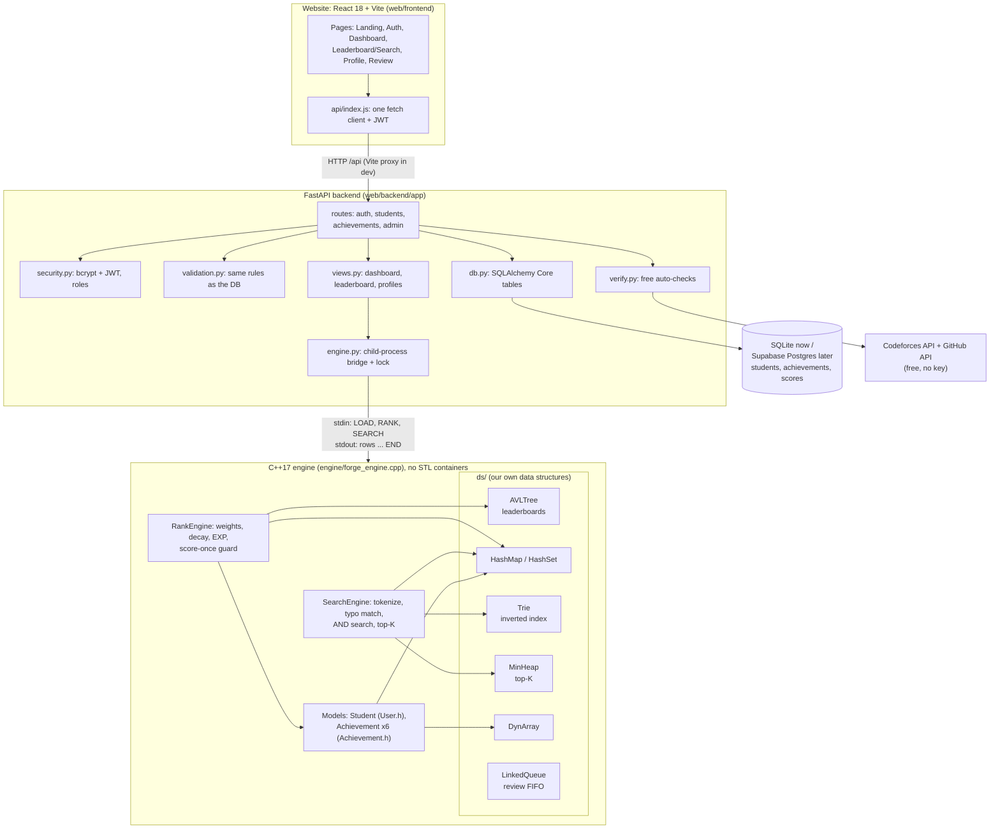
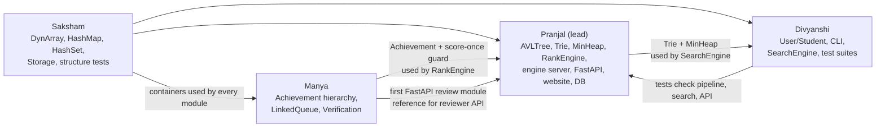

# GEHU Forge: Student Talent and Ranking Platform

A competitive profile platform for Graphic Era Hill University. Students add contests, DSA progress, projects, internships, certificates and academic wins. A reviewer verifies each one, and a C++ engine turns approved work into EXP (0 to 10,000), category ranks and a live college leaderboard.

## System architecture



**How one approval flows:** student submits an achievement → it is saved as `pending` and auto-checked (Codeforces/GitHub) → reviewer approves (`UPDATE ... WHERE status='pending'`, so only one reviewer wins) → the API sends `LOAD` + `RANK` to the C++ engine → the engine rebuilds the AVL leaderboards from approved rows only → new EXP and rank are written to `scores` and shown on the site.

The console version (`main.cpp` + `Cli.h`) uses the same headers, plus `Storage.h` (CSV) and `Verification.h` (LinkedQueue review queue).

The C++ core uses **no STL containers**. Every data structure is our own (`ds/`). `std::string`, streams and `<cmath>` are used. Tests use STL only as an independent checker.

## Team and ownership

| Member | Role | Owns |
|---|---|---|
| **Pranjal Saraswat** | **Team lead, architecture, ranking engine, search data structures, full-stack integration** | `ds/AVLTree.h`, `ds/Trie.h`, `ds/MinHeap.h`, `RankEngine.h`, `Consistency.h`, `engine/forge_engine.cpp`, `web/backend` (API, auth, engine bridge, reviewer API), `web/frontend` (all pages), database design |
| Saksham Singh | Core containers and data | `ds/DynArray.h`, `ds/HashMap.h`, `ds/HashSet.h`, `Storage.h` (CSV load/save, synthetic data generator), `tests/test_structures.cpp` |
| Manya Singh | Achievement model and verification | `Achievement.h`, `ds/LinkedQueue.h`, `Verification.h`, first FastAPI verification module (used as the reference for the final reviewer API) |
| Divyanshi Purohit | Student model, console app, search engine and testing | `User.h` (User, Student, profile card), `Cli.h`, `main.cpp`, `SearchEngine.h`, `tests/TestUtil.h`, `tests/test_pipeline.cpp`, `tests/test_search.cpp`, `web/backend/tests` |

### How the work fits together



- **Interfaces first:** each member owns a header with a fixed public interface, so others could build on it without waiting (for example RankEngine only calls `Achievement::weightedPoints()` and `tryConsumeForScoring()`).
- **Bottom-up order:** containers (Saksham) → models (Manya, Divyanshi) → engines (Pranjal, Divyanshi) → API and website (Pranjal).
- **Tests as the safety net:** structure tests (Saksham) and pipeline, search and API tests (Divyanshi) check every member's code from the outside.
- **Integration:** the lead connected the C++ engine to FastAPI, the database and the website.
- **Branching:** the no-STL rewrite lives on `phase2-no-stl`, so the Phase 1 version on `main` stayed working.

### Pranjal Saraswat (lead)

- **Architecture:** designed how the C++ engine, the Python API, the database and the website fit together, and the API contract all modules follow.
- **AVL tree leaderboard (`ds/AVLTree.h`):** self-balancing BST with rotations and subtree sizes. Insert, erase and rank are O(log N); Top-K is O(K + log N).
- **RankEngine (`RankEngine.h`):** weighted points, daily anti-spam decay, a saturating EXP curve, the consistency multiplier, and the score-once guard. Uses a HashMap for the old EXP (O(1)) and the AVL tree to re-sort (O(log N)). Feeds one overall board and six category boards.
- **Search structures (`ds/Trie.h`, `ds/MinHeap.h`):**
  - A Trie with postings at each word (an inverted index), used for prefix search on names, roll numbers, skills and headlines.
  - A binary min-heap that keeps the best K results in O(N log K). Divyanshi's `SearchEngine.h` is built on both.
- **Engine server (`engine/forge_engine.cpp`):** a long-running process that the API talks to over stdin and stdout (`LOAD`, `RANK`, `SEARCH`). It also computes the table as of seven days ago, for rank movement.
- **Backend (`web/backend`):**
  - FastAPI with bcrypt passwords and JWT login, and student/reviewer roles.
  - Validation that mirrors the database rules.
  - The reviewer queue: oldest first, a conditional update so only one reviewer wins, and automatic proof checks through free Codeforces and GitHub APIs.
  - The engine bridge.
- **Website (`web/frontend`):** the "Arena" design, landing page, dashboard, leaderboard and search, profile and achievement forms, shareable card, and the reviewer page.
- **OOP shown:** encapsulation (RankEngine and SearchEngine keep their maps and trees private), composition (RankEngine has-a AVLTree and HashMaps), templates (`MinHeap<T, Less>`), Rule of Three (Trie and AVL tree own nodes, copying is disabled), and separation of concerns across engine, API and UI.

### Saksham Singh

- **DSA:** `DynArray<T>` (doubling growth, amortised O(1) push), `HashMap<K,V>` (separate chaining, rehash at load factor 0.75, average O(1)), `HashSet<T>` (built on the HashMap).
- **OOP:** class templates, Rule of Three with deep copy and safe self-assignment, composition (HashSet has-a HashMap), RAII destructors.
- **Data:** `DataStore` owns every object and saves to CSV; the seeded generator gives the same data every run. The web seed (`web/database/generate_seed.py`) extends this generator.
- **Tests:** `test_structures.cpp` (46 checks; the random AVL test uses STL as an independent reference).

### Manya Singh

- **OOP:** abstract base class `Achievement` with pure virtual functions. Six derived types (Coding, Certificate, Open source, Internship, DSA, Academic) override the weight and platform multiplier, which is runtime polymorphism. It has a virtual destructor and a template-method `weightedPoints()`.
- **DSA:** `LinkedQueue<T>`, a FIFO queue with front and rear pointers (O(1) enqueue and dequeue), which drives the review order.
- **Verification:** a one-way state machine (Pending to Approved or Rejected), the score-once guard, and the first FastAPI version of the submission and review endpoints.

### Divyanshi Purohit
#Reviewed and tested my part of the project

- **OOP:** abstract `User` and derived `Student` (inheritance), a skills set and achievement list inside each student (composition), const-correct getters, and non-owning pointers. `SearchEngine` has-a Trie, HashSet and HashMap (composition), keeps them private (encapsulation), and builds a MinHeap inside each search.
- **Search engine (`SearchEngine.h`):** tokenizer (`c++` becomes `cpp`), weighted fields (name and roll above skills above the rest), AND search across words, edit distance (dynamic programming, O(m·n)) so small typos like "pyhton" still match, and min-heap top-K. Built on the lead's Trie and MinHeap.
- **DSA:** HashSet for duplicate-free skills, DynArray for achievement lists, Trie postings as an inverted index.
- **Testing:** `TestUtil.h` check helpers, `test_pipeline.cpp` (70 checks: scoring, decay, consistency, verification, ranks), `test_search.cpp` (20 checks), and the API tests in `web/backend/tests` (pytest on a temporary database with the real engine).
- **App:** the menu-driven console program with input validation, the profile card, and the `--demo` mode. The profile card design carried over to the website's shareable card.

## Run everything

```bash
# C++ engine and tests
g++ -std=c++17 -O2 engine/forge_engine.cpp -o engine/forge_engine.exe
g++ -std=c++17 -Wall -Wextra tests/test_structures.cpp -o test_structures.exe && ./test_structures.exe
g++ -std=c++17 -Wall -Wextra tests/test_pipeline.cpp  -o test_pipeline.exe  && ./test_pipeline.exe
g++ -std=c++17 -Wall -Wextra tests/test_search.cpp    -o test_search.exe    && ./test_search.exe

# API (web/backend), see web/backend/README.md
python -m venv .venv && .venv\Scripts\activate && pip install -r requirements.txt
uvicorn app.main:app --reload --port 8000

# Website (web/frontend)
npm install && npm run dev        # http://localhost:5173
```

The console version still works: `g++ -std=c++17 main.cpp -o forge.exe && ./forge.exe` (or `--demo`).

## Data structures

| Structure | File | Used for | Cost |
|---|---|---|---|
| `DynArray<T>` | `ds/DynArray.h` | growable lists | push amortised O(1), index O(1) |
| `HashMap<K,V>` | `ds/HashMap.h` | id lookups, EXP map, daily counters, search scores | average O(1) |
| `HashSet<T>` | `ds/HashSet.h` | skills, search vocabulary | average O(1) |
| `LinkedQueue<T>` | `ds/LinkedQueue.h` | review queue (FIFO) | O(1) |
| `AVLTree` | `ds/AVLTree.h` | leaderboards | insert/erase/rank O(log N), Top-K O(K + log N) |
| `Trie` | `ds/Trie.h` | prefix search with postings | insert/walk O(L) |
| `MinHeap<T, Less>` | `ds/MinHeap.h` | top-K search results | push/pop O(log K) |
| Edit distance | `SearchEngine.h` | typo matching | O(m·n) time, O(n) memory |

## Scoring

1. Category weight: Internship 5.0, Competitive programming 3.5, DSA 3.0, Projects 2.5, Academic 1.5, Certification 1.0.
2. Platform multiplier (competitive programming only): Codeforces 2.5, CodeChef 1.8, LeetCode 1.2, HackerRank 0.8, other 1.0.
3. Daily decay per student per date: items 1 to 5 at 100%, 6 to 10 at 40%, 11 and up at 10%.
4. Base EXP from achievements: `base = 8000 · (1 − e^(−raw / 6000))`. Achievements alone can never pass 8,000, and each extra point is worth a little less.
5. Consistency multiplier (`Consistency.h`, up to ×1.25), so showing up regularly matters:
   - opening Forge: `+0.10 × activeDays(last 30) / 30` and `+0.05 × visitStreak(max 30) / 30`
   - weekly streak of approved achievements: `+0.10 × weeks(max 8) / 8`
6. `EXP = min(10000, base × multiplier)`. Only the overall board uses the multiplier; category boards use the base EXP.
7. Tiers: Candidate 0, Specialist 2,000, Expert 4,500, Master 7,000, Grandmaster 9,000. Master needs a strong record *and* steady activity; Grandmaster needs both near the maximum. On the seed data: 95 Candidate, 103 Specialist, 39 Expert, 2 Master, 0 Grandmaster.
8. Ties go to the smaller student id. Only approved achievements count, each exactly once.
9. Every signed-in student visit is stored once per day (`activity` table). The API sends the last 60 days to the engine with `LOAD`; the engine turns dates into day numbers and checks streaks with a HashSet in O(30 + 7·8) per student.

## Known limitations

- Demo buttons (`DEMO_MODE`) are for evaluation and must be off in real use. There is no password reset or email verification yet.
- LeetCode, certificates and internships have no free verification API, so a reviewer checks those links by hand.
- The seeded students and achievements are synthetic. Their proof links are placeholders.
- The seeded daily activity is synthetic (deterministic per student), like the rest of the seed data.
